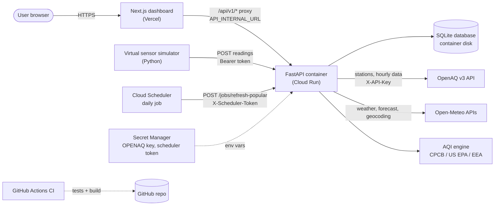
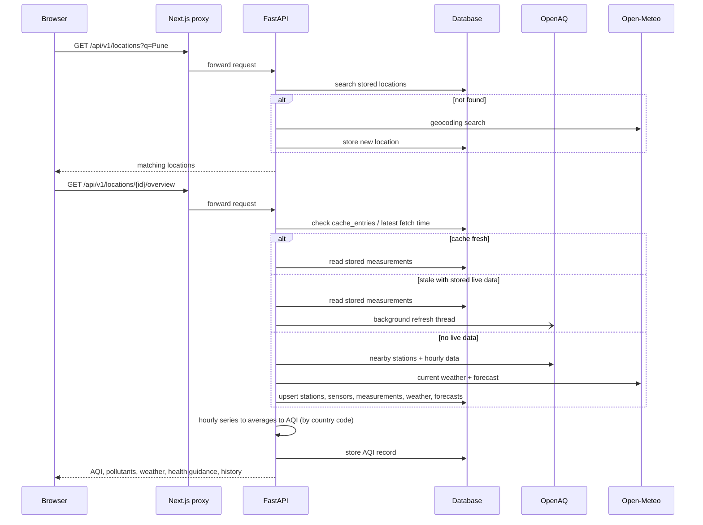
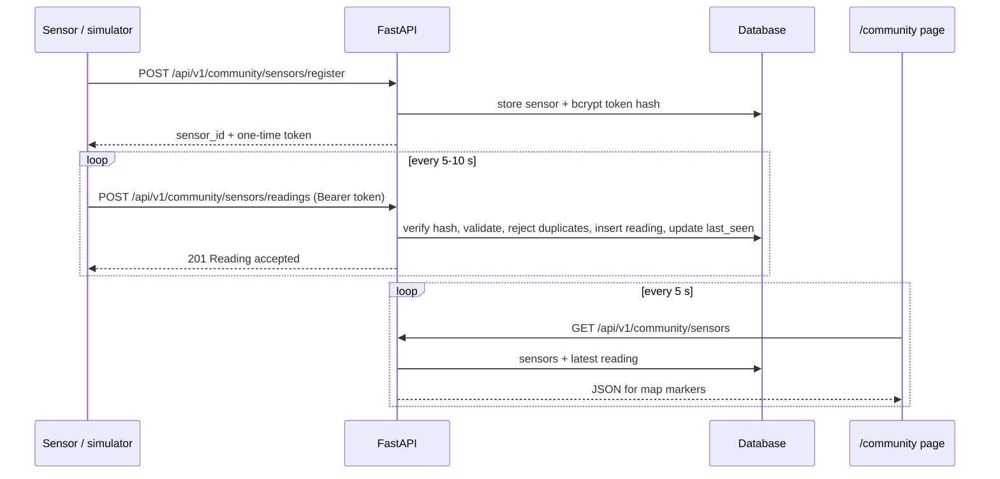
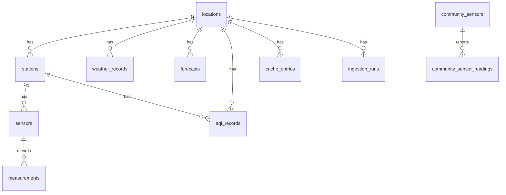
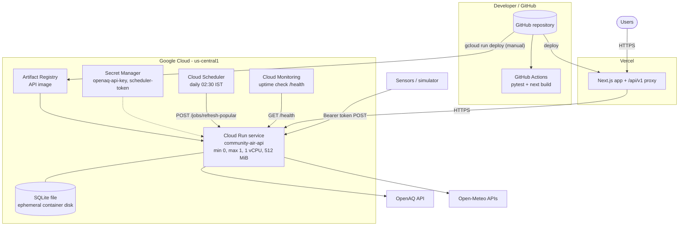

# Community Air Quality & Environmental Health Dashboard: Project Documentation

## Table of Contents

1. [Project Title and Summary](#1-project-title-and-summary)
2. [Scope](#2-scope)
3. [Features Implemented](#3-features-implemented)
4. [Project Architecture](#4-project-architecture)
5. [Cloud Computing Focus](#5-cloud-computing-focus)
   - [5a. Tech Stack](#5a-tech-stack)
   - [5b. API Reference](#5b-api-reference)
   - [5c. Deployment Model](#5c-deployment-model)
6. [Setup and Run Instructions](#6-setup-and-run-instructions)
7. [Testing Approach](#7-testing-approach)
8. [Limitations and Future Work](#8-limitations-and-future-work)
9. [Repository Map](#9-repository-map)

---

## 1. Project Title and Summary

**Title:** Community Air Quality & Environmental Health Dashboard (`community-air`, API title "Community Air Quality API", version 0.1.0).

A cloud computing project that shows air quality for any searchable place. A **FastAPI** backend collects monitoring-station data from OpenAQ and weather and model forecasts from Open-Meteo. It computes an Air Quality Index (AQI) with the standard that matches the location's country (India CPCB, US EPA, or European EEA), stores the results in a database, and serves them to a **Next.js** dashboard. A second subsystem, the **Community Sensor Network**, lets IoT-style sensors (simulated by a Python program) register, authenticate with bearer tokens, post PM2.5/PM10 readings, and appear live on a map.

The system follows a containerized serverless model. The API is a Docker container intended for Google Cloud Run. The dashboard is a Next.js app intended for Vercel. Google Cloud Scheduler triggers a periodic data refresh. According to `README.md`, the public site is https://community-air-quality.vercel.app.

---

## 2. Scope

### 2.1 Objectives

- Show current air quality, pollutant values, weather and health guidance for a chosen place.
- Calculate AQI with a published methodology and never invent values when the inputs are insufficient.
- Keep official observations separate from model estimates (forecasts, weather).
- Demonstrate cloud patterns: stateless containerized API, scheduled jobs, caching of third-party API calls, secrets handling, health/metrics endpoints, CI.
- Demonstrate a device-to-cloud ingestion path (authenticated IoT readings) using simulated sensors.

### 2.2 Target users

- Residents who want to check local air quality and basic precautions.
- Students and reviewers evaluating the project as a cloud computing system.
- Community members who want to contribute low-cost sensor readings (demonstrated with virtual sensors).

### 2.3 In scope

- City and place search (seeded cities plus on-demand geocoding).
- Multi-standard AQI: CPCB, US EPA, European EEA.
- Station readings, history (hourly or daily), multi-city comparison, CSV export, model forecast.
- Community sensor registration, authenticated ingestion, map and history views.
- Scheduled refresh of popular cities, health and metrics endpoints, Docker packaging, CI.

### 2.4 Out of scope and limitations (summary)

- Not a medical tool. Health guidance is general category text (`backend/app/guidance.py` adds this disclaimer to every response).
- Community sensor data is **simulated** and does not feed the official AQI.
- No user accounts or login for the dashboard; no push alerts.
- Persistent storage on the cloud deployment is SQLite on the container disk, which is lost when Cloud Run scales to zero (see [section 8](#8-limitations-and-future-work)).

---

## 3. Features Implemented

### 3.1 Air quality calculation

| Feature | What it does | Implemented in |
|---|---|---|
| Multi-standard AQI | Picks the methodology from the ISO country code and returns AQI, category, dominant pollutants and per-pollutant sub-indices. | `backend/app/aqi/__init__.py` (`calculate_aqi_for_location`), `backend/app/aqi/resolver.py` |
| CPCB (India) | National AQI, version `CPCB-NAQI-2014`. Overall AQI is the worst sub-index. Requires at least 3 valid pollutants including PM2.5 or PM10. Scale 0 to 500. | `backend/app/aqi/cpcb.py` |
| US EPA | Version `US-EPA-AQI-2016`, breakpoints for PM2.5, PM10 and others, with truncation and interpolation helpers. Scale 0 to 500. | `backend/app/aqi/us_epa.py`, `backend/app/aqi/base.py` |
| European EEA | Version `EEA-AQI-2021`, six bands from Good to Extremely Poor. Gauge maximum 150 (`max_scale` in `AQIOut`). | `backend/app/aqi/european.py` |
| Country to standard mapping | `IN` is CPCB, `US` is US EPA, EU/EEA countries plus GB, NO, IS, LI, CH are European. Any other country returns `unavailable` with an explanatory reason. | `backend/app/aqi/resolver.py` |
| Category metadata | Names, CSS codes, colours and gauge maximum per methodology for the UI. | `backend/app/aqi/categories.py` |
| Averaging and coverage rules | Builds 24-hour, 8-hour (CO, O3) and 1-hour (O3 above 208 µg/m³) averages from hourly data. 24-hour pollutants need at least 16 hourly values, 8-hour need at least 6. Missing values are never treated as zero. | `backend/app/aggregate.py` |
| Unit and name normalisation | Maps provider parameter names and units to canonical ones (for example CO to mg/m³). | `backend/app/normalize.py` |
| Legacy module | `backend/app/aqi.py` is the older CPCB-only file. The `backend/app/aqi/` package has the same import name and is the one Python resolves. | `backend/app/aqi/` |

### 3.2 Location and data access

| Feature | What it does | Implemented in |
|---|---|---|
| Seeded popular cities | Eight Indian cities (New Delhi, Mumbai, Bengaluru, Kolkata, Chennai, Hyderabad, Pune, Ahmedabad) with labelled synthetic sample stations, loaded on first start when the database is empty. | `backend/app/cities.py`, `backend/app/seed.py`, `backend/app/database.py` |
| Place search and on-demand discovery | Searches stored locations; if nothing matches, geocodes the query through Open-Meteo, prefers Indian matches, and stores the place. | `backend/app/services/dashboard.py` (`search_locations`, `discover_location`), `GET /api/v1/locations` |
| External data clients | `OpenAQClient` (stations, hourly sensor data, rate-limit aware) and `OpenMeteoClient` (geocoding, current weather, air-quality forecast, hourly weather). `open_clients()` builds them per request or per job. OpenAQ is only created when `OPENAQ_API_KEY` is set. | `backend/app/clients.py`, `backend/app/providers/openaq.py`, `backend/app/providers/openmeteo.py` |
| Ingestion pipeline | Upserts stations, sensors and hourly measurements, stores weather and forecasts, and records every run (`success`, `partial`, `skipped`, `failed`) in `ingestion_runs`. | `backend/app/services/ingest.py` |
| Cache and stale-while-revalidate | A fetch is remembered in `cache_entries` for `CACHE_TTL_MINUTES`. When stored live data exists, the overview returns it immediately and refreshes in a background thread. | `backend/app/services/cache.py`, `backend/app/services/dashboard.py` |
| Freshness labelling | Marks data as fresh or stale using `STALE_AFTER_MINUTES`, and labels the data origin (`sample`, `openaq`, `unavailable`). | `backend/app/services/dashboard.py` |

### 3.3 Dashboard analytics

| Feature | Implemented in |
|---|---|
| Overview per location: AQI, pollutant cards, weather, stations, history, sources, warnings | `backend/app/services/dashboard.py` (`build_overview`), `GET /api/v1/locations/{id}/overview` |
| History by hours or by UTC date range, hourly or daily buckets (max 14 days hourly, 90 days daily) | `backend/app/services/analytics.py` (`ranged_history`), `GET /api/v1/locations/{id}/history` |
| Compare 2 to 4 locations | `backend/app/services/analytics.py` (`compare_locations`), `backend/app/routers/compare.py` |
| CSV export (max 31 days) | `backend/app/services/analytics.py` (`export_csv`), `GET /api/v1/locations/{id}/export` |
| Model forecast kept in its own table so it cannot be read as an observation | `backend/app/services/forecasts.py`, `Forecast` model, `GET /api/v1/locations/{id}/forecast` |
| Station list, station detail, paginated raw measurements | `backend/app/routers/stations.py` |
| Health guidance by AQI category (non-CPCB categories are mapped to the closest CPCB text) | `backend/app/guidance.py` (`guidance_for`) |

### 3.4 Community Sensor Network

| Feature | Implemented in |
|---|---|
| Sensor registration with a bearer token; only a bcrypt hash is stored | `backend/app/routers/community_sensors.py` (`POST /community/sensors`) |
| Contributed-sensor registration (name, hardware ID, hardware model, contributor name). The server assigns IDs such as `SENSOR_011`, with retry on collision. | `POST /community/sensors/register`, `ContributedSensorRegisterRequest` in `backend/app/schemas.py` |
| Authenticated reading ingestion with validation (PM2.5 < 500, PM10 < 1000, temperature -40 to 60 °C, humidity 0 to 100, coordinate ranges, duplicate sequence numbers rejected). Contributed sensors must send coordinates. | `POST /community/sensors/readings` |
| Sensor list, detail, paginated readings with time filter, map feed | `GET /community/sensors`, `/sensors/{id}`, `/sensors/{id}/readings`, `/map` |
| Seed script for 10 Bengaluru virtual sensors; writes plaintext tokens to a git-ignored local file | `backend/app/seed_community_sensors.py` |
| Migration for contributed-sensor columns | `backend/migrations/001_add_contributed_sensor_fields.sql`, `backend/migrations/run_migration.py` |
| `/community` page: Leaflet map with colour-coded markers, 5-second polling, sensor details, Recharts history, "Add Sensor" modal | `frontend/src/app/community/page.tsx`, `frontend/src/components/community/` |

### 3.5 Virtual sensor simulator

`backend/app/simulator/virtual_sensors.py` simulates IoT devices. It loads tokens and locations from JSON files, fetches sensor metadata from the API, and posts a reading about every 5 to 10 seconds with slowly changing values. CLI flags: `--api-url`, `--tokens-file`, `--locations-file`, `--spike SENSOR_ID`, `--duration`, `--disconnect SENSOR_ID`, `--reconnect SENSOR_ID`. `backend/app/simulator/provisioning.py` writes a new sensor's token to the tokens file when `SIMULATOR_AUTO_PROVISION` is true (local demo only; Docker Compose enables it). Guides: `backend/SIMULATOR_QUICKSTART.md`, `backend/app/simulator/README.md`.

### 3.6 Scheduled refresh job

`backend/app/jobs/refresh_popular.py` refreshes every location with `is_popular = true`. It runs two ways:

- As a process: `python -m app.jobs.refresh_popular` (Docker Compose `scheduler` service, profile `job`).
- Over HTTP: `POST /api/v1/jobs/refresh-popular` (`backend/app/routers/jobs.py`), guarded by the `X-Scheduler-Token` header. This is the route Cloud Scheduler calls.

### 3.7 Operations endpoints

`GET /api/v1/health` and `GET /api/v1/metrics` (`backend/app/routers/health.py`) support uptime checks and show ingestion and cache counters.

### 3.8 Frontend

Next.js App Router pages: `/` (dashboard), `/explore`, `/history`, `/community`, `/about` (under `frontend/src/app/`). Components include the AQI gauge, station map, trend and compare charts, and analytics panels (`frontend/src/components/`). A catch-all route handler `frontend/src/app/api/v1/[...path]/route.ts` proxies `/api/v1/*` to the backend, so the browser never calls OpenAQ, Open-Meteo or the backend directly.

---

## 4. Project Architecture

### 4.1 Component overview

| Component | Responsibility | Location |
|---|---|---|
| Browser UI | Renders pages, maps and charts; calls same-origin `/api/v1/*` | `frontend/src/` |
| Next.js server (BFF proxy) | Serves pages and forwards `/api/v1/*` to FastAPI using `API_INTERNAL_URL` (60 s max duration) | `frontend/src/app/api/v1/[...path]/route.ts` |
| FastAPI app | Routers, CORS, dependency-injected DB session, startup table creation and seeding | `backend/app/main.py`, `backend/app/routers/` |
| Service layer | Overview assembly, ingestion, caching, analytics, forecasts | `backend/app/services/` |
| AQI engine | Country-based methodology selection and calculation | `backend/app/aqi/` |
| Provider clients | HTTP clients for OpenAQ and Open-Meteo | `backend/app/providers/`, `backend/app/clients.py` |
| Persistence | SQLAlchemy models and session factory (SQLite with WAL mode) | `backend/app/models.py`, `backend/app/database.py` |
| Scheduler job | Refreshes popular cities | `backend/app/jobs/refresh_popular.py` |
| Simulator | Virtual IoT sensors posting readings | `backend/app/simulator/` |

### 4.2 Architecture diagram



### 4.3 Data flow: viewing a location



### 4.4 Data flow: community sensor reading



### 4.5 Data model

Defined in `backend/app/models.py`. Tables are created at startup with `Base.metadata.create_all`.



| Table | Key columns | Notes |
|---|---|---|
| `locations` | id, name, city, country, country_code, latitude, longitude, timezone, is_popular | `country_code` selects the AQI standard. `is_popular` selects the scheduled-refresh set. |
| `stations` | id, location_id, provider, external_id, name, latitude, longitude, is_monitor | Unique `(provider, external_id)`. Provider is `sample` or `openaq`. |
| `sensors` | id, station_id, external_id, parameter, unit | Unique `(station_id, parameter)`. |
| `measurements` | id, sensor_id, value, unit, measured_at, fetched_at, source, averaging_period | Unique `(sensor_id, measured_at, averaging_period)`, indexed by sensor and time. |
| `aqi_records` | location_id, station_id, aqi, category, dominant_pollutant, available, reason, methodology, source_type, inputs_json, calculated_at | Stores the calculated result and its methodology. |
| `weather_records` | location_id, temperature_c, humidity_percent, wind_speed_kmh, wind_direction_deg, precipitation_mm, recorded_at, fetched_at, source, kind | Model estimates. |
| `forecasts` | location_id, parameter, value, unit, forecast_for, fetched_at, source, kind | Unique per location, parameter, time and kind. |
| `cache_entries` | cache_key (unique), provider, location_id, fetched_at, expires_at, payload_ref, hit_count | Records when a location was last fetched from a provider. |
| `ingestion_runs` | provider, location_id, started_at, completed_at, status, error | Audit of every refresh. |
| `community_sensors` | id (string), name, latitude, longitude, sensor_type, auth_token_hash, status, source, hardware_id, hardware_model, contributor_name, created_at, last_seen | Token stored only as a bcrypt hash. Coordinates are nullable for newly registered contributed sensors. |
| `community_sensor_readings` | sensor_id, sequence_number, pm25, pm10, temperature, humidity, latitude, longitude, recorded_at, received_at, quality_status | Unique `(sensor_id, sequence_number)`, indexed by sensor and time. |

---

## 5. Cloud Computing Focus

### 5a. Tech Stack

Versions come from `backend/requirements.txt`, `frontend/package.json`, `backend/Dockerfile`, `frontend/Dockerfile` and `.github/workflows/ci.yml`. Frontend versions are the declared semver ranges.

| Layer | Technology | Version | Why it was used |
|---|---|---|---|
| Language (backend) | Python | 3.12 (`python:3.12-slim` image, CI) | Good fit for data processing and the FastAPI ecosystem. |
| API framework | FastAPI | 0.115.6 | Typed routes, automatic OpenAPI docs at `/docs`, light enough for a small container. |
| ASGI server | Uvicorn (standard) | 0.34.0 | Runs the app; binds to Cloud Run's `PORT`. |
| ORM | SQLAlchemy | 2.0.36 | Same models work on SQLite now and on a server database later through `DATABASE_URL`. |
| Validation and settings | Pydantic / pydantic-settings | 2.10.4 / 2.7.0 | Response schemas and environment-based configuration (`backend/app/config.py`). |
| HTTP client | httpx | 0.28.1 | Calls to OpenAQ and Open-Meteo with timeouts. |
| Device auth | bcrypt through `passlib[bcrypt]` | 1.7.4 | Hashing of sensor tokens. The router imports `bcrypt` directly; it is installed by the passlib extra. |
| Other | requests | 2.31.0 | Listed in requirements. |
| Testing | pytest | 8.3.4 | Backend tests, run in CI. |
| Database | SQLite (WAL mode, 30 s busy timeout) | bundled with Python | Zero cost and no extra service. Cloud SQL is deliberately not used (see README). |
| Frontend framework | Next.js | ^15.1.6 | Server-side proxy hides the API URL and key-bearing backend from browsers; deploys directly to Vercel. |
| UI | React / React DOM | ^19.0.0 | Component UI. |
| Maps and charts | Leaflet ^1.9.4, react-leaflet ^5.0.0, Recharts ^2.15.1 | as listed | Station and sensor maps, trend and comparison charts. |
| Styling | Tailwind CSS ^3.4.17, PostCSS, Autoprefixer, lucide-react ^1.72.0 | as listed | Utility styling and icons. |
| Language (frontend) | TypeScript | ^5.7.3 | Typed API payloads (`frontend/src/lib/types.ts`). |
| Frontend runtime | Node.js | 22 (`node:22-alpine` image), 20 in CI | Build and serve Next.js. |
| Containers | Docker, Docker Compose | n/a | Same image locally and on Cloud Run. |
| CI | GitHub Actions (`actions/checkout@v4`, `setup-python@v5`, `setup-node@v4`) | n/a | Tests and build on every push and pull request. |
| Cloud (per README) | Google Cloud Run, Cloud Scheduler, Secret Manager, Artifact Registry, Cloud Monitoring; Vercel | n/a | Scale-to-zero compute and free-tier friendly hosting. |

### 5b. API Reference

**Base URL:** `/api/v1` on the FastAPI service (locally `http://127.0.0.1:8000`). Routers are mounted with this prefix in `backend/app/main.py`. The dashboard reaches the same paths through the Next.js proxy. Interactive docs: `/docs`; OpenAPI JSON: `/openapi.json` (FastAPI defaults).

**Conventions:** JSON responses. Errors use `{"detail": "..."}` with 400, 401, 403, 404, 422, or 502. CORS allows `GET` and `POST` from `CORS_ORIGINS`.

> The Next.js proxy forwards only the method, query string and body, with an `accept` header. It does not forward the `Authorization` header. Sensors therefore post to the FastAPI service directly (as the simulator does), not through the dashboard.

#### 5b.1 Endpoint summary

| # | Method | Path | Purpose | Auth |
|---|---|---|---|---|
| 1 | GET | `/` | Service banner (no `/api/v1` prefix) | None |
| 2 | GET | `/api/v1/health` | Liveness check | None |
| 3 | GET | `/api/v1/metrics` | Ingestion and cache counters | None |
| 4 | GET | `/api/v1/locations` | Search or discover locations | None |
| 5 | GET | `/api/v1/locations/{location_id}/overview` | Full dashboard payload | None |
| 6 | GET | `/api/v1/locations/{location_id}/aqi` | AQI only, from stored data | None |
| 7 | GET | `/api/v1/locations/{location_id}/history` | Stored history | None |
| 8 | GET | `/api/v1/locations/{location_id}/forecast` | Open-Meteo model forecast | None |
| 9 | GET | `/api/v1/locations/{location_id}/export` | CSV download | None |
| 10 | GET | `/api/v1/locations/{location_id}/weather` | Stored weather | None |
| 11 | POST | `/api/v1/locations/{location_id}/refresh` | Fetch provider data now | None |
| 12 | GET | `/api/v1/locations/{location_id}/stations` | Stations of a location | None |
| 13 | GET | `/api/v1/stations/{station_id}` | One station | None |
| 14 | GET | `/api/v1/stations/{station_id}/measurements` | Raw measurements, paginated | None |
| 15 | GET | `/api/v1/compare` | Compare 2 to 4 locations | None |
| 16 | POST | `/api/v1/jobs/refresh-popular` | Refresh popular cities | `X-Scheduler-Token` header |
| 17 | POST | `/api/v1/community/sensors` | Register sensor with caller-chosen ID and coordinates | None |
| 18 | POST | `/api/v1/community/sensors/register` | Register contributed sensor, server-assigned ID | None |
| 19 | POST | `/api/v1/community/sensors/readings` | Submit a reading | `Authorization: Bearer <token>` |
| 20 | GET | `/api/v1/community/sensors` | List sensors with latest reading | None |
| 21 | GET | `/api/v1/community/sensors/{sensor_id}` | One sensor | None |
| 22 | GET | `/api/v1/community/sensors/{sensor_id}/readings` | Paginated readings | None |
| 23 | GET | `/api/v1/community/map` | Sensors with coordinates for the map | None |

#### 5b.2 Endpoint details

**1. `GET /`**
```json
{"service": "community-air-api", "docs": "/docs"}
```

**2. `GET /api/v1/health`**
```json
{"status": "ok", "service": "community-air-api"}
```

**3. `GET /api/v1/metrics`** returns `MetricsOut`:
```json
{
  "popular_locations": 8, "on_demand_locations": 2,
  "measurements": 1240, "forecasts": 300,
  "cache_entries": 3, "cache_hits": 0,
  "latest_ingestions": [
    {"id": 12, "provider": "openaq", "location_id": 1,
     "started_at": "2025-01-01T21:00:00Z", "completed_at": "2025-01-01T21:00:04Z", "status": "success"}
  ],
  "note": "The API process is stateless. ..."
}
```

**4. `GET /api/v1/locations`**

| Parameter | In | Type | Default | Notes |
|---|---|---|---|---|
| `q` | query | string, max 80 | `""` | Search text. If nothing is stored, the place is geocoded through Open-Meteo and saved. |
| `limit` | query | int 1 to 50 | 20 | Result cap. |

```json
{"results": [{"id": 1, "name": "New Delhi", "city": "New Delhi", "country": "India",
  "country_code": "IN", "latitude": 28.6139, "longitude": 77.209,
  "timezone": "Asia/Kolkata", "is_popular": true}]}
```

**5. `GET /api/v1/locations/{location_id}/overview`**: `hours` (query, int 1 to 168, default 48). May trigger a provider fetch when a key is configured and the cache is stale. Returns `OverviewOut`: `location`, `freshness`, `data_origin`, `warnings`, `summary_station`, `aqi`, `pollutants`, `health`, `weather`, `stations`, `history`, `sources`. Trimmed example:
```json
{
  "freshness": "fresh", "data_origin": "openaq", "warnings": [],
  "aqi": {"available": true, "value": 142, "category": "Moderate",
          "dominant_pollutants": ["pm25"], "methodology": "CPCB-NAQI-2014",
          "methodology_display": "Indian AQI (CPCB)", "max_scale": 500,
          "source_type": "observation", "sub_indices": []},
  "health": {"category": "Moderate", "summary": "...", "precautions": ["..."],
             "disclaimer": "General category guidance only. It is not a medical assessment."}
}
```
404 `Location not found.` for an unknown ID.

**6. `GET /api/v1/locations/{location_id}/aqi`**: no parameters. Computed from stored data only; returns the `aqi` object above.

**7. `GET /api/v1/locations/{location_id}/history`**

| Parameter | Type | Notes |
|---|---|---|
| `hours` | int 1 to 336 | Used when no dates are given (default 48). |
| `start`, `end` | date (`YYYY-MM-DD`) | Both or neither. Max span 14 days for `hour`, 90 for `day`. |
| `bucket` | `hour` or `day` | Default `hour`. |

Response `HistoryOut`: `location_id`, `station_id`, `station_name`, `hours`, `bucket`, `start`, `end`, `points[{measured_at, aqi, category, pollutants{}}]`, `note`. 422 on invalid ranges.

**8. `GET /api/v1/locations/{location_id}/forecast`**: returns `ForecastOut` (`source`, `cache`, `fetched_at`, `expires_at`, `points[{forecast_for, parameter, display_name, value, unit, kind}]`, `note`). 502 `The model forecast could not be loaded.` if Open-Meteo fails.

**9. `GET /api/v1/locations/{location_id}/export`**: `start`, `end` (dates, both or neither, max 31 days; default last 48 hours). Returns `text/csv` with `Content-Disposition: attachment; filename="<city>-measurements.csv"`.

**10. `GET /api/v1/locations/{location_id}/weather`**: returns `WeatherOut` (`temperature_c`, `humidity_percent`, `wind_speed_kmh`, `wind_direction_deg`, `precipitation_mm`, `recorded_at`, `source`, `kind`, `label`). 404 if none stored.

**11. `POST /api/v1/locations/{location_id}/refresh`**: no body. Returns `RefreshOut`:
```json
{"location_id": 1, "status": "success", "message": "Location data was refreshed.",
 "stations_updated": 3, "measurements_stored": 410}
```
Without `OPENAQ_API_KEY`, status is `skipped` and stored readings are unchanged. 502 on provider error.

**12. `GET /api/v1/locations/{location_id}/stations`**: list of `StationOut` (`id`, `name`, `provider`, `latitude`, `longitude`, `is_monitor`, `aqi`, `pollutants[]`). 404 for an unknown location.

**13. `GET /api/v1/stations/{station_id}`**: one `StationOut`; 404 `Station not found.`

**14. `GET /api/v1/stations/{station_id}/measurements`**: `parameter` (string, max 16), `limit` (1 to 1000, default 200), `offset` (default 0). Returns `{station_id, count, limit, offset, results[{parameter, value, unit, measured_at, fetched_at, source, averaging_period}]}`.

**15. `GET /api/v1/compare?ids=1,2,3`**: `ids` is a comma-separated list of 2 to 4 distinct location IDs (max 40 characters). Returns `CompareOut` with `locations[{location, freshness, data_origin, summary_station, measured_at, aqi, pollutants}]` and `note`. 422 for non-numeric IDs or the wrong count; 404 for unknown IDs.

**16. `POST /api/v1/jobs/refresh-popular`**: header `X-Scheduler-Token: <SCHEDULER_TOKEN>`, compared in constant time. 401 `Scheduler token is missing or incorrect.` when the token is wrong or `SCHEDULER_TOKEN` is unset.
```json
{"refreshed": 8, "results": [{"id": 1, "name": "New Delhi", "status": "success",
  "message": "Location data was refreshed.", "stations_updated": 3, "measurements_stored": 410}]}
```

**17. `POST /api/v1/community/sensors`** (status 201)
```json
// request
{"sensor_id": "SENSOR_900", "name": "Rooftop", "latitude": 12.97, "longitude": 77.59, "sensor_type": "virtual"}
// response
{"sensor_id": "SENSOR_900", "token": "<token shown once>", "message": "Sensor registered successfully. Store this token securely."}
```
400 `Sensor ID already registered.` for a duplicate.

**18. `POST /api/v1/community/sensors/register`** (status 201). All four fields are required (length-limited).
```json
// request
{"name": "My Home Sensor", "hardware_id": "ESP32-HOME001",
 "hardware_model": "ESP32 + PMS5003", "contributor_name": "A. Person"}
// response
{"sensor_id": "SENSOR_011", "token": "<token shown once>",
 "ingestion_url": "/api/v1/community/sensors/readings",
 "message": "Sensor registered successfully. Store the token securely; it cannot be retrieved later."}
```
The sensor has no coordinates until its first reading.

**19. `POST /api/v1/community/sensors/readings`** (status 201). Header `Authorization: Bearer <token>`.
```json
// request
{"sensor_id": "SENSOR_011", "sequence_number": 1, "pm25": 38.5, "pm10": 62.0,
 "temperature": 27.1, "humidity": 55, "latitude": 12.9352, "longitude": 77.6245,
 "recorded_at": "2025-01-01T10:00:00Z"}
// response
{"message": "Reading accepted.", "sensor_id": "SENSOR_011", "sequence_number": 1}
```
Errors: 401 missing or invalid token; 403 sensor not active; 400 for out-of-range values, missing coordinates on a contributed sensor, or a duplicate `sequence_number`.

**20. `GET /api/v1/community/sensors`**: list of `CommunitySensorOut` (`id`, `name`, `latitude`, `longitude`, `sensor_type`, `status`, `source`, `hardware_id`, `hardware_model`, `contributor_name`, `created_at`, `last_seen`, `latest_reading`).

**21. `GET /api/v1/community/sensors/{sensor_id}`**: one `CommunitySensorOut`; 404 `Sensor not found.`

**22. `GET /api/v1/community/sensors/{sensor_id}/readings`**: `limit` (1 to 1000, default 100), `offset`, `start`, `end` (datetimes). Newest first. Each item has `sensor_id`, `sequence_number`, `pm25`, `pm10`, `temperature`, `humidity`, `latitude`, `longitude`, `recorded_at`, `received_at`, `quality_status`.

**23. `GET /api/v1/community/map`**
```json
{"sensors": [{"id": "SENSOR_001", "name": "Koramangala Sensor 1", "latitude": 12.9352,
  "longitude": 77.6245, "sensor_type": "virtual", "status": "active", "source": "seed",
  "last_seen": "2025-01-01T10:00:05Z",
  "latest_reading": {"pm25": 38.5, "pm10": 62.0, "temperature": 27.1, "humidity": 55,
                     "recorded_at": "2025-01-01T10:00:00Z"}}]}
```

#### 5b.3 External APIs consumed

| API | Used for | Call details | Auth | Code |
|---|---|---|---|---|
| OpenAQ v3 (`OPENAQ_BASE_URL`, default `https://api.openaq.org/v3`) | Nearby monitoring stations and hourly sensor data | `GET /locations`, `GET /sensors/{id}/hours`. First tries India (`iso=IN`), then a global search. The client tracks rate-limit headers and waits for budget. | `X-API-Key` header from `OPENAQ_API_KEY` | `backend/app/providers/openaq.py` |
| Open-Meteo Forecast (`OPENMETEO_FORECAST_URL`) | Current and hourly weather (temperature, humidity, wind speed, precipitation) | `GET` | None | `backend/app/providers/openmeteo.py` |
| Open-Meteo Air Quality (`OPENMETEO_AIR_QUALITY_URL`) | Pollutant forecast (PM2.5, PM10, CO, NO2, SO2, O3), shown as a model estimate | `GET` | None | `backend/app/providers/openmeteo.py` |
| Open-Meteo Geocoding (`https://geocoding-api.open-meteo.com/v1/search`, fixed in code) | Turn a place name into coordinates and country code | `GET` | None | `backend/app/providers/openmeteo.py` |
| OpenStreetMap tiles (`https://tile.openstreetmap.org/{z}/{x}/{y}.png`) | Base map in the browser | Leaflet tile layer in the map components | None | `frontend/src/components/station-map.tsx`, `frontend/src/components/community/CommunitySensorMap.tsx` |

Without an OpenAQ key the app runs on the labelled sample dataset. Weather and forecasts need no key.

### 5c. Deployment Model

#### 5c.1 Service model

**Containerized serverless (PaaS-style compute with managed supporting services)**:

- Backend: a Docker container on **Google Cloud Run** (managed, request-billed, scale-to-zero). This is Container-as-a-Service on the PaaS/serverless side. There are no VMs to manage (not IaaS).
- Frontend: **Vercel** (PaaS) running the Next.js server, which includes the API proxy.
- Scheduling: **Cloud Scheduler** calling an HTTP endpoint. The scheduled work runs inside the same API service, not in a separate function.
- Third-party data: OpenAQ and Open-Meteo are consumed as SaaS APIs.

#### 5c.2 Cloud provider and services

The repository contains the Dockerfiles, Compose file, CI workflow and application code. It contains **no infrastructure-as-code** (no Terraform, `service.yaml` or `vercel.json`). The Google Cloud and Vercel setup below is as described in `README.md` and is configured outside the repo.

| Concern | Service | Configuration per README |
|---|---|---|
| API compute | Cloud Run service `community-air-api`, region `us-central1` | Min instances 0, max 1, 1 vCPU, 512 MiB, request-based billing |
| Image registry | Artifact Registry | Holds the backend image |
| Scheduled compute | Cloud Scheduler job `refresh-popular` | Daily at 02:30 Asia/Kolkata, sends `POST /api/v1/jobs/refresh-popular` to the API |
| Secrets | Secret Manager | `openaq-api-key`, `scheduler-token` |
| Monitoring | Cloud Run logs, Cloud Monitoring uptime check | Checks `/api/v1/health` every 15 minutes |
| Frontend hosting | Vercel (Hobby plan) | `API_INTERNAL_URL` points to the Cloud Run URL |
| Database | SQLite inside the container | Cloud SQL is intentionally not used |

Not used (per README): load balancer, NAT gateway, Cloud SQL, message queue.

#### 5c.3 Containerization

- **Backend image** (`backend/Dockerfile`): `python:3.12-slim`; installs `requirements.txt`; copies `app/`; creates `/app/data`; sets `DATABASE_URL=sqlite:////app/data/airquality.db`; exposes 8000; starts `uvicorn app.main:app --host 0.0.0.0 --port ${PORT:-8000}`. Cloud Run supplies `PORT`; Compose leaves it unset. `.dockerignore` and `.gcloudignore` exclude `.venv/`, caches, `data/` and `*.db`.
- **Frontend image** (`frontend/Dockerfile`): `node:22-alpine`; `npm install`, `npm run build`, `npm start`; exposes 3000.
- **Docker Compose** (`docker-compose.yml`): services `backend` (8000), `frontend` (3000, `API_INTERNAL_URL=http://backend:8000`), `simulator` (virtual devices posting to `http://backend:8000`), and `scheduler` (profile `job`, one-shot). A shared `air-data` volume holds the SQLite file and simulator token files.

#### 5c.4 Deployment diagram



#### 5c.5 CI/CD pipeline

`.github/workflows/ci.yml` runs on every `push` and `pull_request` with two parallel jobs on `ubuntu-latest`:

1. **backend**: checkout, Python 3.12, `pip install -r backend/requirements.txt`, `pytest` in `backend/`.
2. **frontend**: checkout, Node 20 with npm cache keyed on `frontend/package-lock.json`, `npm ci`, `npm run build`.

The workflow does continuous integration only. Per README, the API deploy is a manual `gcloud run deploy` from the repository (image built from `backend/`), and Vercel deploys the frontend. The workflow has no deploy step.

#### 5c.6 Environment configuration

Settings are read by `backend/app/config.py` (pydantic-settings) from environment variables, falling back to `.env` or `../.env`. `.env.example` lists the names. Real values must never be committed.

| Variable | Default | Purpose |
|---|---|---|
| `OPENAQ_API_KEY` | empty | Enables live OpenAQ data. Empty means sample data. Secret. |
| `OPENAQ_BASE_URL` | `https://api.openaq.org/v3` | OpenAQ endpoint |
| `OPENMETEO_FORECAST_URL` | `https://api.open-meteo.com/v1/forecast` | Weather endpoint |
| `OPENMETEO_AIR_QUALITY_URL` | `https://air-quality-api.open-meteo.com/v1/air-quality` | Pollutant forecast endpoint |
| `DATABASE_URL` | `sqlite:///./data/airquality.db` | SQLAlchemy URL (the Docker image overrides it to `/app/data`) |
| `CACHE_TTL_MINUTES` | 30 | Provider-fetch and forecast cache lifetime |
| `STALE_AFTER_MINUTES` | 180 | Age after which data is labelled stale |
| `CORS_ORIGINS` | `http://localhost:3000` | Comma-separated allowed origins |
| `SCHEDULER_TOKEN` | empty | Shared secret for the refresh route. Empty disables the route (always 401). Secret. |
| `SIMULATOR_AUTO_PROVISION` | false | Local demo only: writes new sensor tokens to a file for the simulator |
| `SIMULATOR_TOKENS_FILE` | `data/sensor_tokens.json` | Where the tokens are written |
| `API_INTERNAL_URL` | `http://127.0.0.1:8000` | Used by the Next.js server to reach FastAPI |
| `PORT` | 8000 in the image | Set by Cloud Run |

#### 5c.7 Scheduled jobs

Cloud Scheduler calls `POST /api/v1/jobs/refresh-popular` with the `X-Scheduler-Token` header. Running the job inside the API service is deliberate: a separate Cloud Run job would write its own SQLite file, which the website could not see (`backend/app/routers/jobs.py`, README). Locally, `python -m app.jobs.refresh_popular` or the Compose `scheduler` profile runs the same function. Non-popular cities are refreshed on demand when someone opens them.

#### 5c.8 Scaling

- The API process keeps no request state. Shared state is in the database tables (`measurements`, `forecasts`, `cache_entries`).
- Cloud Run is capped at one instance (per README). This is required by the SQLite design, since several instances would each hold a different database file. Raising the cap needs a shared database such as Cloud SQL (SQLAlchemy supports this through `DATABASE_URL`).
- SQLite runs in WAL mode with a 30-second busy timeout to tolerate concurrent requests and background refresh threads (`backend/app/database.py`).
- Third-party calls are limited by the cache TTL and the OpenAQ client's rate-limit handling.

#### 5c.9 Security

- **Secrets** stay in environment variables or Secret Manager. `.env` is git-ignored and only `.env.example` is committed. The OpenAQ key is used only by the backend; the browser never sees it.
- **Scheduler endpoint** requires a shared token compared with `secrets.compare_digest`.
- **Sensor authentication**: tokens are generated with `secrets.token_urlsafe`, shown once, and stored as bcrypt hashes. Readings require `Authorization: Bearer`, and inactive sensors get 403.
- **Input validation**: FastAPI/Pydantic limits on query parameters; range checks on sensor readings; parameterised queries through SQLAlchemy.
- **CORS** is restricted to configured origins, methods `GET` and `POST`, no credentials.
- **Backend reachability**: the browser talks to the Next.js proxy, which returns a generic 502 when the API is unreachable.
- **Known gaps**: the read endpoints and sensor-registration endpoints are unauthenticated and not rate-limited. The registration response returns the token, so HTTPS is required (Cloud Run and Vercel provide it). `SIMULATOR_AUTO_PROVISION` must stay off outside local demos because it writes plaintext tokens to disk.

#### 5c.10 Cost and observability

- **Cost target (README):** zero rupees inside free allowances: Cloud Run request and CPU allowance, one of three free Cloud Scheduler jobs, Secret Manager's free versions, 0.5 GB Artifact Registry, free uptime-check executions, and Vercel Hobby. Passing a Vercel cap pauses that feature; passing a Google cap can bill, so a budget alert is set at ₹0.
- **Region split:** Cloud Run runs in Iowa (`us-central1`) and Vercel serves the website, so most user traffic uses Vercel bandwidth and the outbound traffic from Cloud Run stays inside the free gigabyte.
- **Logging:** `logging.basicConfig(level=INFO)` in `backend/app/main.py`; Cloud Run collects stdout. Provider failures are logged as warnings.
- **Metrics:** `GET /api/v1/metrics` exposes counts of popular and on-demand locations, measurements, forecasts, cache entries and hits, plus the eight latest ingestion runs.
- **Audit trail:** each refresh writes an `ingestion_runs` row with status and error text.
- **Health check:** `GET /api/v1/health`, polled by the Cloud Monitoring uptime check (per README).

---

## 6. Setup and Run Instructions

### 6.1 Prerequisites

Python 3.12, Node.js 20 or newer (22 in the Docker image), npm, Docker with Compose (optional). An OpenAQ key is optional (`https://explore.openaq.org/register`).

### 6.2 Local, without Docker

```bash
# Backend
cd backend
python3 -m venv .venv
source .venv/bin/activate
pip install -r requirements.txt
uvicorn app.main:app --reload --port 8000     # docs at http://127.0.0.1:8000/docs

# Frontend (second terminal)
cd frontend
npm install
npm run dev                                    # http://localhost:3000
```

Optional live data: `cp .env.example .env`, set `OPENAQ_API_KEY`, restart the API, then use "Refresh data" on a city or run `python -m app.jobs.refresh_popular` from `backend/`. The SQLite file is created at `backend/data/airquality.db` on first start; delete it to rebuild the sample data.

Community sensors (backend running on port 8000):
```bash
cd backend && source .venv/bin/activate
python -m app.seed_community_sensors                           # creates 10 sensors and data/sensor_tokens.json
python -m app.simulator.virtual_sensors --api-url http://localhost:8000
python -m app.simulator.virtual_sensors --api-url http://localhost:8000 --spike SENSOR_001 --duration 60
```
The simulator's default `--api-url` is `http://localhost:8001`, so pass the URL explicitly when the API runs on 8000. Open http://localhost:3000/community to see the map. See also `backend/SIMULATOR_QUICKSTART.md`, `DEMO_TESTING_GUIDE.md` and `RESTART_BACKEND.md`.

### 6.3 Local, with Docker Compose

```bash
cp .env.example .env          # optional, only for the OpenAQ key
docker compose up --build     # backend :8000, frontend :3000, simulator
docker compose --profile job run --rm scheduler    # one-shot popular-city refresh
```

### 6.4 Cloud deployment (Google Cloud Run + Vercel)

The commands below show the pattern; project names, URLs and secret values are placeholders. The deployed setup itself is described in `README.md`.

```bash
# 1. Build and push the API image
gcloud builds submit backend --tag us-central1-docker.pkg.dev/<PROJECT>/<REPO>/community-air-api

# 2. Store secrets
printf '%s' "<OPENAQ_KEY>"      | gcloud secrets create openaq-api-key --data-file=-
printf '%s' "<RANDOM_TOKEN>"    | gcloud secrets create scheduler-token --data-file=-

# 3. Deploy with scale-to-zero and a single instance (matches the SQLite design)
gcloud run deploy community-air-api \
  --image us-central1-docker.pkg.dev/<PROJECT>/<REPO>/community-air-api \
  --region us-central1 --allow-unauthenticated \
  --min-instances 0 --max-instances 1 --cpu 1 --memory 512Mi \
  --set-env-vars CORS_ORIGINS=https://<your-vercel-domain>,COMMUNITY_DEMO_MODE=true \
  --set-secrets OPENAQ_API_KEY=openaq-api-key:latest,SCHEDULER_TOKEN=scheduler-token:latest

# 4. Daily refresh (02:30 Asia/Kolkata)
gcloud scheduler jobs create http refresh-popular \
  --location us-central1 --schedule "30 2 * * *" --time-zone "Asia/Kolkata" \
  --http-method POST --uri https://<CLOUD_RUN_URL>/api/v1/jobs/refresh-popular \
  --headers "X-Scheduler-Token=<SCHEDULER_TOKEN>"
```

`COMMUNITY_DEMO_MODE=true` makes the API seed the ten Bengaluru community sensors on startup and generate simulated readings when community data is read, because the deployment has no simulator process (see README, "Community sensors in the deployed demo"). Deploy the `frontend/` directory to Vercel and set `API_INTERNAL_URL` to the Cloud Run URL. `backend/.gcloudignore` keeps local databases and virtual environments out of source uploads.

---

## 7. Testing Approach

- **Backend automated tests**: pytest (`backend/pytest.ini`: `pythonpath = .`, `testpaths = tests`). 34 tests pass locally (`cd backend && pytest`):
  - `tests/test_aqi.py` (10): AQI calculation and coverage rules.
  - `tests/test_api.py` (8): API endpoints through FastAPI's test client.
  - `tests/test_stage2.py` (13): ingestion, caching, history, forecasts, export and the scheduled job.
  - `tests/test_simulator_provisioning.py` (3): token provisioning for the simulator.
  - `tests/conftest.py`: shared fixtures.
- **Continuous integration**: `.github/workflows/ci.yml` runs `pytest` and `npm run build` (which also type-checks the frontend) on every push and pull request.
- **Manual and integration checks**: `DEMO_TESTING_GUIDE.md`, `backend/test_simulator.sh`, `backend/verify_integration.py` and `backend/run_simulator_testclient.py` support end-to-end demos of the sensor flow.
- **Not covered**: there are no frontend unit tests, no load tests, and no tests for the deployed cloud environment.

---

## 8. Limitations and Future Work

### Limitations

1. **Ephemeral storage on Cloud Run.** SQLite lives on the container disk. After scale-to-zero, stored measurements, forecasts and **registered community sensors** are lost, and the app reloads the sample set and refetches live data.
2. **Single instance.** The one-instance cap is a consequence of SQLite and limits throughput and availability.
3. **Simulated community data.** Virtual sensors are not hardware; community readings are not used to compute AQI and are not calibrated or quality-scored (`quality_status` is always `accepted` after validation).
4. **Sensor-ID generation.** Contributed IDs come from `MAX(id)+1`; collisions are retried up to three times, and the code comments note it is not safe under heavy concurrency.
5. **Unauthenticated public endpoints.** No rate limiting or user accounts; sensor registration is open.
6. **AQI coverage.** Only India, the US and EU/EEA plus a few European countries have an AQI. Other countries return "unavailable" with a reason. Countries with their own national index (UK DAQI, German UBA) use the pan-European index as an approximation (noted in `resolver.py`). The seeded sample cities are all Indian.
7. **Provider dependence.** Live data depends on OpenAQ coverage and rate limits, and an OpenAQ key. Open-Meteo values are model estimates, not observations.
8. **Health guidance** is general text and not personalised medical advice.
9. **Sensors and the dashboard proxy.** The Next.js proxy drops the `Authorization` header, so real devices must post to the FastAPI URL directly.
10. **Manual deployment.** CI does not deploy, and no infrastructure-as-code is stored in the repo.
11. **Schema changes.** Tables are created by `create_all`; changes to existing tables need manual SQL migrations (`backend/migrations/`).
12. **Dead code.** `backend/app/aqi.py` duplicates logic that now lives in `backend/app/aqi/`.

### Future work

- Move to a managed database (Cloud SQL or similar) to persist data and allow multiple Cloud Run instances.
- Add continuous deployment steps (build, push, `gcloud run deploy`) to the GitHub Actions workflow and describe the infrastructure with Terraform.
- Add rate limiting and API keys or user accounts for registration and write endpoints; use UUID sensor IDs.
- Support real devices (ESP32 with PMS5003) with calibration, outlier detection and fusion of community readings with official stations.
- Add national AQI standards (UK DAQI, German UBA) and more countries.
- Use Cloud Monitoring alerting policies, structured logging and tracing; add frontend and end-to-end tests.
- Add alerts or notifications for pollution spikes, and use a message queue for high-volume ingestion.

---

## 9. Repository Map

| Path | Contents |
|---|---|
| `backend/app/main.py` | FastAPI app factory, CORS, router mounting |
| `backend/app/config.py` | Environment-based settings |
| `backend/app/database.py`, `backend/app/models.py` | Session factory, SQLite WAL setup, ORM models |
| `backend/app/aqi/` | `base.py`, `categories.py`, `cpcb.py`, `us_epa.py`, `european.py`, `resolver.py` |
| `backend/app/aggregate.py`, `normalize.py`, `guidance.py`, `timeutils.py` | Averaging, unit mapping, health text, time helpers |
| `backend/app/cities.py`, `seed.py`, `seed_community_sensors.py` | Sample cities and seed scripts |
| `backend/app/clients.py`, `backend/app/providers/` | OpenAQ and Open-Meteo clients |
| `backend/app/routers/` | `health.py`, `locations.py`, `stations.py`, `compare.py`, `jobs.py`, `community_sensors.py` |
| `backend/app/services/` | `dashboard.py`, `ingest.py`, `cache.py`, `analytics.py`, `forecasts.py` |
| `backend/app/jobs/refresh_popular.py` | Scheduled refresh |
| `backend/app/simulator/` | Virtual sensor simulator and token provisioning |
| `backend/migrations/` | SQL migration and runner |
| `backend/tests/` | pytest suite |
| `backend/Dockerfile`, `.dockerignore`, `.gcloudignore` | Container and upload rules |
| `frontend/` | Next.js dashboard, API proxy, Dockerfile |
| `.github/workflows/ci.yml` | CI pipeline |
| `docker-compose.yml`, `.env.example` | Local multi-container setup and variable names |
| `README.md`, `IMPLEMENTATION_GUIDE.md`, `DEMO_TESTING_GUIDE.md`, `RESTART_BACKEND.md`, `backend/SIMULATOR_QUICKSTART.md` | Existing guides |
| `.agents/tasks/` | Design, plan, review and verification notes for the community sensor and global AQI work |
